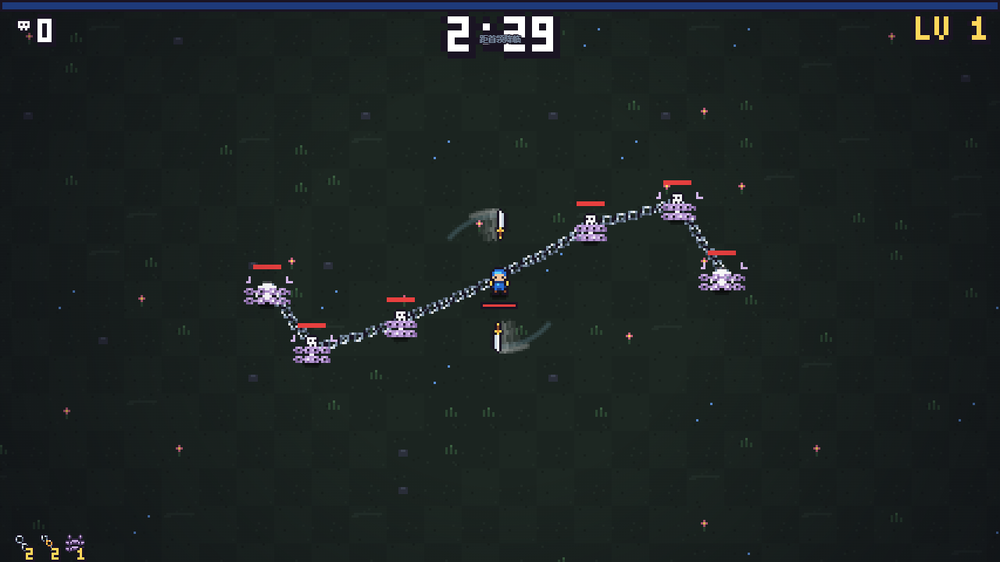

# 剑环 · Blade Orbit v0.4.3

双击本目录的 `start-game.cmd` 开始游戏，也可以直接用 Chrome / Edge 打开 `index.html`。无需安装依赖或联网。入口路径保持稳定，版本由 Git 和游戏标题记录。

WASD / 方向键移动，也可按住鼠标移动。剑自动攻击；升级时点击卡牌或按 1 / 2 / 3，R 重抽，P / Esc 暂停，M 静音。

## 预览与试听

[下载或试听 v0.4.3 新技能音效](docs/media/audio-v0.4.3.wav)。前半按发射、串联、命中、拉紧、断裂、回收、禁锢施加、解除的顺序播放，末尾为密集叠音测试。

从 GitHub 使用 Code → Download ZIP 下载整个仓库，解压后进入 `blade-orbit-ByCC`，双击 `start-game.cmd`。GitHub 的文件预览页不能直接运行游戏。

## v0.4.3：锁链与禁锢音效

沿用现有 WebAudio 实时合成系统，不需要联网或外部音频资源。新增锁链发射、连环续射、命中、拉紧、断裂、回收，以及禁锢施加、解除，共 8 种声音。金属声由非整数倍泛音与短噪声包络组成，禁锢以低沉下滑音收紧、轻上滑音解除。锁链命中替代通用受击声。

拉紧声每条锁链至少间隔 0.65 秒，并设置全局 0.32 秒限频；其他新音效也各有限频。进入剑环后不播放拉紧声，禁锢敌人死亡不播放解除声；暂停和升级期间不产生新技能音效。M 静音和原有存档设置保持有效。修正了音频时间恰为零时的重复播放限频。

18 项自动检查通过；Chrome 实时 AudioContext 已解锁运行，离线渲染确认 8 种声音有输出、密集触发无削波。声音强弱与最终听感仍可结合实际游玩调整。

## v0.4.2：轻型锁链与淡紫禁锢（历史）

普通锁链保留钢铁色阶和相扣结构，链节从约 11×7 缩为 6×4 游戏像素（约半尺寸，受整数像素限制），端点与钩爪同步缩小。禁锢去掉挂锁，束缚链、收紧提示和技能图标统一使用淡紫色负面状态色阶。技能机制与数值不变。

## v0.4.1：锁链与禁锢美术重制（历史）

锁链改为有真实镂空的长环与侧面窄环交替相扣，使用 32 方向像素采样，避免斜链灰边和断口。禁锢改为横绕胸腹的两道实体链、背面暗段和胸前金属挂锁；命中时锁链从两侧收紧。移除了悬浮紫色锁、脚下光圈和外扩大环。同步重绘三张技能卡图标。技能数值与机制沿用 v0.4.0。

## 技能说明（v0.4.0 加入）

- **锁链**：升级卡池中可获得，1 级同时 1 条，每级 +1，最多 5 条。自动索敌，命中伤害为当前剑伤害的 115%，持续拉向玩家；体重越大越难拉。进入现有最外剑环后停止施加拉力，连接仍保留。每段连接超过 160 游戏像素断裂，死亡或断裂后整条链沿路径收回，完全消失后独立冷却 1 秒。
- **铁索连环**：持有锁链才进入卡池。每条锁链额外串联 1 名附近敌人，最多叠加 2 次，即每条链最多连接 3 名敌人。敌人之间也有双向拉力。任何敌人只能被一条锁链占用，飞行中的锁链也会预占目标。
- **禁锢锁链**：持有锁链才进入卡池，一次获取。锁链每次命中时禁锢，首次 3 秒，重复施加时长为 `3 / (1 + 0.65 × 此前连续施加次数)` 秒。不会缩短尚未结束的禁锢；10 秒未施加后抗性重置。禁锢停止自主移动，但仍能攻击，仍受拉扯和击退。

初始发射范围 112 游戏像素，连环索敌范围 72 游戏像素。以上为本版初始平衡参数，可在 `game.js` 的 `CHAIN` 和升级卡定义中调整。

普通锁链沿用钢铁色阶：空心链节、飞行钩爪、回收暗链；禁锢使用淡紫色贴身束链。

## 版本和验证

原有代码保存于 Git 的 `baseline-round3` 标签；技能初版为 `v0.4.0`，最新音效版本为 `v0.4.3`，无需在主目录复制多份代码。

已安装 Node 时，在本目录运行 `node --test tests/*.test.cjs` 可执行技能逻辑回归测试。自动检查不代表实机难度和手感已经由玩家验收。
